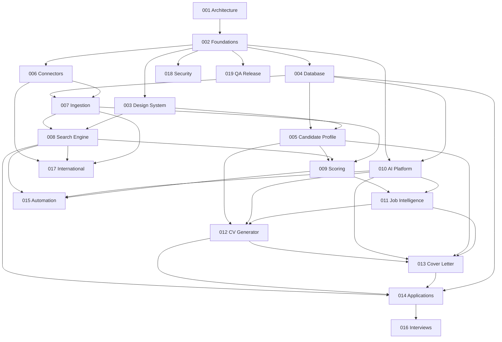

# HAPPLY AI
# MASTER PRODUCT BACKLOG — EPICS, FEATURES & ENGINEERING TASKS

**Version :** 1.0  
**Type :** Product & Technical Delivery Roadmap  
**Architecture :** Clean Architecture / Modular Monolith / DDD pragmatique  
**Méthodologie :** Agile / Incremental Delivery / Test-Driven Development lorsque pertinent  
**Niveau de qualité :** Production-oriented engineering

---

# PARTIE 1 — ORGANISATION DU PROJET

## 1.1 Hiérarchie du backlog

Le projet sera organisé selon quatre niveaux.

```text
PROJECT
  |
  +-- EPIC
        |
        +-- FEATURE
              |
              +-- USER STORY
                    |
                    +-- TASK
                          |
                          +-- SUBTASK
```

### EPIC

Une grande capacité fonctionnelle ou technique du produit.

Exemple : moteur de recherche d'emploi.

### FEATURE

Une fonctionnalité appartenant à un EPIC.

Exemple : recherche multi-sources.

### USER STORY

Un besoin utilisateur concret.

Exemple : en tant qu'utilisateur, je veux rechercher des offres dans plusieurs pays.

### TASK

Une unité de travail technique, suffisamment petite pour être développée, testée et validée.

Exemple : implémenter l'interface commune des connecteurs.

## 1.2 Convention de nommage

Utiliser des identifiants stables.

```text
JH-EPIC-001
JH-FEAT-001
JH-US-001
JH-TASK-001
```

Les identifiants ne doivent jamais être réutilisés.

Chaque tâche doit disposer, dans `PROJECT_BACKLOG.md` (voir TASK-001-10), de :

- ID.
- Titre.
- Description.
- Objectif.
- Dépendances.
- Fichiers ou modules concernés.
- Critères d'acceptation.
- Tests requis.
- Definition of Done.
- Priorité.
- Estimation.

## 1.3 Priorités

| Priorité | Signification |
|---|---|
| P0 | Bloquant, indispensable |
| P1 | Important pour le MVP |
| P2 | Amélioration fonctionnelle |
| P3 | Fonctionnalité avancée |

## 1.4 États du backlog

```text
BACKLOG
READY
IN_PROGRESS
IN_REVIEW
TESTING
DONE
BLOCKED
```

Une tâche ne peut être marquée DONE que si ses critères d'acceptation sont vérifiés.

### Légende des statuts visuels

| Emoji | Signification | Équivalent d'état |
|---|---|---|
| [✅] | Réalisé et validé (Definition of Done satisfaite) | `DONE` |
| [➖] | Non réalisé ou non validé | `BACKLOG`, `READY`, `IN_PROGRESS`, `IN_REVIEW`, `TESTING`, `BLOCKED` |

Règles d'application :

- Chaque EPIC, FEATURE, TASK et critère d'acceptation porte son emoji devant son titre.
- Une TASK passe de [➖] à [✅] uniquement lorsque la Definition of Done (Partie 5.2) est satisfaite, avec tests réellement exécutés.
- Une FEATURE est [✅] uniquement si toutes ses TASKS sont [✅].
- Un EPIC est [✅] uniquement si toutes ses FEATURES sont [✅] et tous ses critères d'acceptation sont [✅].
- L'état fin (`IN_PROGRESS`, `BLOCKED`, etc.) est noté dans `PROJECT_BACKLOG.md` ; ce document ne conserve que [✅] ou [➖].
- Mettre à jour le tableau de pilotage (Partie 8) à chaque changement de statut.

## 1.5 Règles de développement

- Un EPIC ne doit pas être considéré comme terminé si ses fonctionnalités critiques ne sont pas testées.
- Une FEATURE doit être intégrable indépendamment.
- Une TASK doit avoir un périmètre clair.
- Une tâche bloquée doit expliquer sa dépendance.
- Les migrations de base de données doivent être versionnées.
- Les contrats API doivent être documentés.
- Les décisions architecturales importantes doivent faire l'objet d'un ADR.
- Aucun faux connecteur ne doit être présenté comme opérationnel.
- Aucun test ne doit être déclaré réussi sans exécution réelle.

---

# PARTIE 2 — PHASAGE GLOBAL

Le développement est réparti en cinq grandes phases.

| Phase | Objectif | EPICs |
|---|---|---|
| Phase 0 | Cadrage et architecture | 001 |
| Phase 1 | Fondations techniques | 002 à 005 |
| Phase 2 | Moteur de recherche | 006 à 009 |
| Phase 3 | Intelligence et documents | 010 à 013 |
| Phase 4 | Gestion et automatisation | 014 à 016 |
| Phase 5 | Internationalisation, sécurité et livraison | 017 à 019 |

L'ordre précis des tâches dépend des relations de dépendance indiquées ci-dessous.

---

# PARTIE 3 — BACKLOG DÉTAILLÉ DES EPICS

# [➖] EPIC 001 — PRODUCT DISCOVERY & SOFTWARE ARCHITECTURE

**Priorité : P0 — Fondamental**

**Objectif :** établir une architecture cohérente avant de développer les fonctionnalités métier.

### [✅] FEATURE 001.1 — Analyse de l'environnement

[✅] **TASK-001-01 — Inspecter le dépôt**

- Analyser les fichiers existants.
- Identifier les technologies.
- Identifier les dépendances.
- Identifier les scripts.
- Identifier les éventuels composants déjà développés.

[✅] **TASK-001-02 — Identifier les contraintes**

- Environnement local.
- Systèmes d'exploitation cibles.
- Accès Internet.
- Fournisseurs IA.
- Sources d'offres.
- Contraintes financières.
- Contraintes de confidentialité.

[✅] **TASK-001-03 — Définir les objectifs, le périmètre et les critères de réussite** (produit robuste, pas un MVP jetable ; voir `docs/product/PRODUCT_REQUIREMENTS.md`)

- Identifier les fonctionnalités indispensables.
- Distinguer les fonctionnalités différables.
- Définir les premiers parcours utilisateur.
- Établir les critères de réussite.

### [✅] FEATURE 001.2 — Architecture logicielle

[✅] **TASK-001-04 — Concevoir l'architecture globale**

Définir :
- Frontend.
- Backend.
- Domain.
- Application.
- Infrastructure.
- Persistence.
- Connecteurs.
- IA.
- Stockage.

[✅] **TASK-001-05 — Définir les bounded contexts**

Identifier les domaines :
- Candidate Profile.
- Job Discovery.
- Job Intelligence.
- AI Management.
- Document Generation.
- Application Management.
- Interview Preparation.
- Notifications.

[✅] **TASK-001-06 — Définir les contrats intermodules**

Documenter les interfaces et les dépendances.

[✅] **TASK-001-07 — Définir les conventions de développement**

- Nommage.
- Typage.
- Gestion des erreurs.
- Structure des tests.
- Logs.
- Formatage.
- Validation.

### [✅] FEATURE 001.3 — Architecture documentaire

[✅] **TASK-001-08 — Créer ARCHITECTURE.md**

[✅] **TASK-001-09 — Créer les premiers ADR** (voir `docs/architecture/ADR/`)

ADR obligatoires :
- Authentification différée et exécution locale.
- Choix du monolithe modulaire.
- Choix du backend.
- Choix du frontend.
- Choix de la base de données.
- Stratégie IA.
- Stratégie des connecteurs.
- Stratégie de stockage documentaire.

### [✅] FEATURE 001.4 — Pilotage documentaire

[✅] **TASK-001-10 — Produire `PROJECT_BACKLOG.md` détaillé** (voir `docs/product/PROJECT_BACKLOG.md`)

- Reprendre chaque TASK de ce backlog avec son statut, sa priorité et les dépendances et critères de son EPIC ; l'estimation et les tests requis sont fixés au passage `READY` (voir 1.2 et 5.1).
- Ce fichier devient le registre vivant des statuts ; le présent document reste la référence de périmètre.

[✅] **TASK-001-11 — Créer l'arborescence `docs/`** (index : `docs/README.md` ; les documents propres à un EPIC sont créés avec lui)

- Selon la structure décrite en Partie 8.

### Critères d'acceptation

- [✅] Architecture documentée.
- [✅] Dépendances définies.
- [✅] Responsabilités des modules identifiées.
- [✅] Choix technologiques justifiés.
- [➖] Périmètre produit validé par le propriétaire (voir docs/product/PRODUCT_REQUIREMENTS.md).
- [✅] Aucun développement métier majeur commencé sans fondations architecturales.

**Livrable :** dossier d'architecture initial.

---

# [➖] EPIC 002 — PROJECT FOUNDATION & DEVELOPER EXPERIENCE

**Priorité : P0 — Fondamental**

**Objectif :** mettre en place un environnement de développement propre, reproductible et maintenable.

### [➖] FEATURE 002.1 — Initialisation du projet

[✅] **TASK-002-01 — Initialiser le repository**

- Structure principale.
- Branches Git.
- `.gitignore`.
- README initial.

[✅] **TASK-002-02 — Initialiser le frontend**

- Next.js.
- React.
- TypeScript strict.
- Configuration des alias.
- Structure des modules.

[✅] **TASK-002-03 — Initialiser le backend**

- FastAPI.
- Pydantic.
- SQLAlchemy.
- Configuration des dépendances.
- Structure Clean Architecture.

[➖] **TASK-002-04 — Configurer les outils qualité**

- Ruff.
- Mypy ou Pyright.
- ESLint.
- Prettier.
- TypeScript checks.
- Pre-commit hooks.

### [➖] FEATURE 002.2 — Configuration et environnements

[✅] **TASK-002-05 — Gestion des variables d'environnement**

- `.env.example`.
- Validation des variables.
- Séparation dev/test/prod.
- Gestion des secrets.

[✅] **TASK-002-06 — Docker Compose**

Prévoir les services nécessaires au démarrage :
- Web.
- API.
- PostgreSQL.
- Services complémentaires uniquement si justifiés.

[➖] **TASK-002-07 — Scripts de développement**

- Start.
- Stop.
- Reset de l'environnement de test.
- Migration.
- Test.
- Lint.
- Build.

[➖] **TASK-002-10 — Mode démonstration**

- Données fictives clairement identifiées comme telles dans l'interface.
- Activable et désactivable explicitement ; jamais mélangées aux données réelles.

[✅] **TASK-002-11 — Outillage de tests de base**

- Pytest.
- Vitest / Testing Library.
- Playwright.

### [➖] FEATURE 002.3 — CI/CD

[➖] **TASK-002-08 — Pipeline CI**

- Installation.
- Vérification des types.
- Lint.
- Tests.
- Build.

[➖] **TASK-002-09 — Protection Git**

- Vérification des secrets.
- Protection des branches principales.
- Vérification des dépendances vulnérables.

### Critères d'acceptation

- [➖] Le projet démarre depuis une installation propre.
- [➖] Frontend et backend communiquent.
- [➖] Les migrations fonctionnent.
- [➖] Les contrôles qualité passent.
- [➖] La CI détecte les régressions.
- [➖] Aucun secret réel n'est versionné.

**Livrable :** socle technique exécutable.

---

# [➖] EPIC 003 — DESIGN SYSTEM & APPLICATION SHELL

**Priorité : P0 — Fondamental**

**Objectif :** créer une interface premium cohérente, inspirée de la philosophie de design Apple.

### [✅] FEATURE 003.1 — Design tokens

[✅] **TASK-003-01 — Définir la palette sombre**

Utiliser les couleurs du cahier des charges initial.

[✅] **TASK-003-02 — Définir les tokens typographiques**

- Font family.
- Font sizes.
- Font weights.
- Line heights.
- Letter spacing.

[✅] **TASK-003-03 — Définir les espacements et dimensions**

- Spacing.
- Radius.
- Borders.
- Shadows.
- Container widths.
- Breakpoints.

[✅] **TASK-003-04 — Définir les états visuels**

- Hover.
- Focus.
- Active.
- Disabled.
- Loading.
- Error.
- Success.

### [✅] FEATURE 003.2 — Composants fondamentaux

[✅] **TASK-003-05 — Développer Button**

[✅] **TASK-003-06 — Développer Input et SearchInput**

[✅] **TASK-003-07 — Développer Select et Dropdown**

[✅] **TASK-003-08 — Développer Badge et StatusBadge**

[✅] **TASK-003-09 — Développer Card et Panel**

[✅] **TASK-003-10 — Développer Modal et Dialog**

[✅] **TASK-003-11 — Développer Table et Pagination**

[✅] **TASK-003-12 — Développer Toast, Tooltip et Skeleton**

[✅] **TASK-003-18 — Développer IconButton, Tabs, FilterPanel et EmptyState**

Composants listés dans la spécification (§15.4) et absents des tâches précédentes.

### [✅] FEATURE 003.3 — Application Shell

[✅] **TASK-003-13 — Créer la Sidebar**

Navigation :
- Dashboard.
- Job Search.
- Saved Jobs.
- CV Studio.
- Cover Letters.
- Applications.
- Interview Preparation.
- AI Center.
- Settings.

[✅] **TASK-003-14 — Créer le Header**

- Recherche globale.
- Notifications.
- Profil.
- Accès aux paramètres.

[✅] **TASK-003-15 — Créer le système de navigation**

[✅] **TASK-003-16 — Créer les pages Empty State**

[✅] **TASK-003-17 — Développer le responsive design**

### Critères d'acceptation

- [➖] Design sombre cohérent.
- [✅] Aucun dégradé sur les textes ou boutons.
- [✅] Couleurs centralisées.
- [✅] Composants réutilisables.
- [✅] Navigation fonctionnelle.
- [✅] Responsive desktop/tablette/mobile.
- [➖] Accessibilité clavier.
- [✅] Contrastes lisibles.

**Livrable :** design system et interface principale.

---

# [➖] EPIC 004 — DATABASE & DOMAIN FOUNDATION

**Priorité : P0 — Fondamental**

**Objectif :** construire une base de données fiable et un modèle métier extensible.

### [✅] FEATURE 004.1 — Modèle de données

[✅] **TASK-004-01 — Définir les entités principales** (toute entité appartenant à l'utilisateur porte un `owner_id`, ADR-0008)

- Candidate.
- CandidateProfile.
- Experience.
- Education.
- Certification.
- Skill.
- Language.
- JobOffer.
- JobSource.
- SearchCriteria.
- SavedSearch.
- JobAnalysis.
- Application.
- GeneratedDocument.
- AIUsage.
- Notification.

[✅] **TASK-004-02 — Définir les Value Objects**

- Money.
- CountryCode.
- LanguageCode.
- EmploymentType.
- RemoteType.
- DateRange.
- SkillLevel.

[✅] **TASK-004-03 — Définir les relations**

- Candidate / Experience.
- Candidate / Education.
- Candidate / Skill.
- JobOffer / Source.
- JobOffer / Analysis.
- Application / JobOffer.
- Application / Documents.

[✅] **TASK-004-04 — Définir les contraintes métier**

- Unicité.
- Intégrité référentielle.
- Champs obligatoires.
- Historisation.

### [➖] FEATURE 004.2 — Persistence Layer

[✅] **TASK-004-05 — Configurer SQLAlchemy**

[✅] **TASK-004-06 — Créer les migrations Alembic**

[➖] **TASK-004-07 — Créer les repositories**

[✅] **TASK-004-08 — Ajouter les index**

Optimiser notamment :
- Source + external ID.
- Country.
- Published date.
- Job title.
- Company.
- Application status.
- Search history.

[✅] **TASK-004-09 — Définir les transactions**

### [✅] FEATURE 004.3 — Infrastructure de données

[✅] **TASK-004-10 — Créer les mécanismes de sauvegarde**

[✅] **TASK-004-11 — Créer la stratégie de restauration**

[✅] **TASK-004-12 — Définir les règles de rétention**

[✅] **TASK-004-13 — Définir la stratégie d'archivage**

- Archivage des offres anciennes sans perte de l'historique utile.
- Pagination côté base : ne jamais charger toutes les offres en mémoire.

### Critères d'acceptation

- [✅] Modèle cohérent.
- [✅] Migrations reproductibles.
- [➖] Repositories testés.
- [✅] Contraintes SQL fonctionnelles.
- [✅] Sauvegarde et restauration documentées.
- [➖] Aucun accès direct à la base depuis la logique métier.

**Livrable :** fondations de persistance.

---

# [➖] EPIC 005 — CANDIDATE PROFILE & MASTER CV

**Priorité : P0 — Fondamental**

**Objectif :** créer le référentiel central du candidat.

### [✅] FEATURE 005.1 — Import des documents

[✅] **TASK-005-01 — Développer l'upload sécurisé**

Formats :
- PDF.
- DOCX.
- TXT.

[✅] **TASK-005-02 — Développer l'extraction PDF**

[✅] **TASK-005-03 — Développer l'extraction DOCX**

[✅] **TASK-005-04 — Normaliser le texte extrait**

[✅] **TASK-005-05 — Détecter les documents malformés**

### [✅] FEATURE 005.2 — Extraction du profil

[✅] **TASK-005-06 — Extraire les coordonnées**

[✅] **TASK-005-07 — Extraire les expériences**

[✅] **TASK-005-08 — Extraire les formations**

[✅] **TASK-005-09 — Extraire les compétences**

[✅] **TASK-005-10 — Extraire les langues et certifications**

Les extractions doivent pouvoir fonctionner avec des règles classiques avant d'utiliser l'IA.

### [➖] FEATURE 005.3 — Validation du CV maître

[➖] **TASK-005-11 — Créer le formulaire de profil**

[➖] **TASK-005-12 — Créer l'éditeur des expériences**

[➖] **TASK-005-13 — Créer l'éditeur des compétences**

[➖] **TASK-005-14 — Créer la gestion des formations**

[➖] **TASK-005-15 — Ajouter la validation des informations extraites**

[✅] **TASK-005-16 — Ajouter l'historique des modifications**

### [➖] FEATURE 005.4 — Profil professionnel

[✅] **TASK-005-17 — Créer le profil maître versionné**

[➖] **TASK-005-18 — Créer la gestion des préférences professionnelles**

- Métiers.
- Pays.
- Villes.
- Télétravail.
- Contrats.
- Salaire.
- Langues de candidature.

### Critères d'acceptation

- [➖] Import de CV fonctionnel.
- [✅] Extraction testée.
- [➖] Modifications possibles.
- [➖] Validation humaine disponible.
- [✅] Profil maître conservé indépendamment des CV ciblés.
- [✅] Traçabilité des informations.
- [✅] Aucune donnée professionnelle inventée.

**Livrable :** profil candidat central.

---

# [➖] EPIC 006 — JOB SOURCE CONNECTOR FRAMEWORK

**Priorité : P0 — Fondamental**

**Objectif :** créer une architecture de connecteurs indépendante des fournisseurs.

### [✅] FEATURE 006.1 — Contrat des connecteurs

[✅] **TASK-006-01 — Définir JobSourceConnector**

Méthodes :
- search.
- get_details.
- health_check.
- get_capabilities.

[✅] **TASK-006-02 — Définir les modèles de requête**

[✅] **TASK-006-03 — Définir les modèles de réponse**

[✅] **TASK-006-04 — Définir les exceptions spécifiques**

### [✅] FEATURE 006.2 — Registre des sources

[✅] **TASK-006-05 — Développer ConnectorRegistry**

[✅] **TASK-006-06 — Ajouter la configuration des sources**

[✅] **TASK-006-07 — Ajouter l'activation et la désactivation**

[✅] **TASK-006-08 — Ajouter le statut de santé**

### [✅] FEATURE 006.3 — Résilience

[✅] **TASK-006-09 — Implémenter les timeouts**

[✅] **TASK-006-10 — Implémenter les retries**

[✅] **TASK-006-11 — Implémenter le rate limiting**

[✅] **TASK-006-12 — Ajouter le circuit breaker si nécessaire**

[✅] **TASK-006-13 — Journaliser les erreurs**

### [➖] FEATURE 006.4 — Premier connecteur réel

[➖] **TASK-006-14 — Étudier les API officielles disponibles**

[➖] **TASK-006-15 — Sélectionner une première source française**

[➖] **TASK-006-16 — Obtenir et configurer les accès nécessaires**

[➖] **TASK-006-17 — Implémenter la recherche réelle**

[➖] **TASK-006-18 — Implémenter la récupération des détails**

[➖] **TASK-006-19 — Écrire les tests avec fixtures et réponses anonymisées**

### [➖] FEATURE 006.5 — Page Sources de données

[➖] **TASK-006-20 — Créer la page Sources de données**

- Nom du fournisseur, pays couverts, statut, dernier accès, dernière erreur.
- Nombre d'annonces récupérées et configuration requise.
- Une source non configurée est clairement signalée comme telle.

### [➖] FEATURE 006.6 — Sites carrières des entreprises (sources publiques uniquement)

**Périmètre strict :** seules les informations publiquement accessibles sont consultées. Aucun contournement de CAPTCHA, d'authentification, de restriction d'accès, de limite technique ou de mesure anti-bot, ni des conditions d'utilisation. Une entreprise dont les pages ne peuvent pas être consultées légitimement est marquée « non supportée » et jamais simulée.

[➖] **TASK-006-21 — Gérer la liste des entreprises ciblées**

- L'utilisateur fournit les entreprises à surveiller et le(s) intitulé(s) de poste recherché(s).

[✅] **TASK-006-22 — Détecter la source publique d'une entreprise**

- Identifier le logiciel de recrutement (ATS) ou la page carrières publique.
- Conserver la méthode de détection et la date.

[➖] **TASK-006-23 — Connecteurs d'API publiques d'ATS**

- Greenhouse, Lever, Ashby, SmartRecruiters, Workable : uniquement les flux publics prévus pour la lecture des offres.
- Vérifier les conditions d'utilisation de chaque fournisseur avant son intégration (TASK-006-14).

[✅] **TASK-006-24 — Extraction des données structurées `JobPosting` (schema.org)**

- Lire uniquement les données structurées publiques des pages carrières.

[➖] **TASK-006-25 — Lecture de pages publiques conditionnée à l'autorisation**

- Lire et respecter `robots.txt` et les CGU avant toute requête.
- Limiter le débit, User-Agent honnête, cache pour éviter les requêtes répétées.
- Abandonner proprement en cas de refus (403, CAPTCHA, connexion demandée) : aucun contournement.

[✅] **TASK-006-26 — Filtrer les offres d'entreprise par intitulé de poste**

- Filtrage déterministe (niveau 0), sans appel IA.

[✅] **TASK-006-27 — Sécuriser les requêtes sortantes (SSRF)**

- Liste de destinations autorisées, blocage des adresses internes, validation des URL de redirection.

[✅] **TASK-006-28 — Tests avec fixtures anonymisées**

- Cas nominal, page non supportée, accès refusé, `robots.txt` restrictif, structure modifiée.

### Critères d'acceptation

- [➖] Connecteur interchangeable.
- [➖] Premier fournisseur réellement fonctionnel.
- [➖] Gestion des erreurs.
- [➖] Respect des quotas et conditions d'utilisation.
- [➖] Aucune source simulée présentée comme réelle.
- [➖] Un connecteur indisponible ne bloque pas les autres.

**Livrable :** infrastructure de recherche multi-sources.

---

# [✅] EPIC 007 — JOB INGESTION, NORMALIZATION & DEDUPLICATION

**Priorité : P0 — Fondamental**

**Objectif :** centraliser et fiabiliser les offres issues de différentes sources.

### [✅] FEATURE 007.1 — Ingestion

[✅] **TASK-007-01 — Créer le Job Ingestion Service**

[✅] **TASK-007-02 — Ajouter les tâches asynchrones**

[✅] **TASK-007-03 — Gérer les résultats paginés**

[✅] **TASK-007-04 — Gérer les erreurs partielles**

### [✅] FEATURE 007.2 — Normalisation

[✅] **TASK-007-05 — Normaliser les intitulés**

[✅] **TASK-007-06 — Normaliser les pays et villes**

[✅] **TASK-007-07 — Normaliser les contrats**

[✅] **TASK-007-08 — Normaliser les devises**

[✅] **TASK-007-09 — Normaliser les dates et fuseaux horaires**

[✅] **TASK-007-10 — Préserver les données originales**

### [✅] FEATURE 007.3 — Déduplication

[✅] **TASK-007-11 — Détection par identifiant externe**

[✅] **TASK-007-12 — Détection par URL canonique**

[✅] **TASK-007-13 — Détection multicritère**

[✅] **TASK-007-14 — Calcul de similarité textuelle**

[✅] **TASK-007-15 — Gestion des offres multi-sources**

### [✅] FEATURE 007.4 — Cycle de vie des annonces

[✅] **TASK-007-16 — Détection des annonces expirées**

[✅] **TASK-007-17 — Gestion des annonces modifiées**

[✅] **TASK-007-18 — Historisation des changements**

[✅] **TASK-007-19 — Nettoyage des annonces obsolètes selon politique de rétention**

### Critères d'acceptation

- [✅] Données normalisées.
- [✅] Doublons contrôlés.
- [✅] Historique conservé.
- [✅] Offres correctement reliées à leurs sources.
- [✅] Ingestion résiliente.
- [✅] Aucun doublon créé lors de la relance d'une tâche.

**Livrable :** pipeline fiable de collecte d'offres.

---

# [➖] EPIC 008 — JOB SEARCH ENGINE & SEARCH EXPERIENCE

**Priorité : P0 — Fondamental**

**Objectif :** permettre à l'utilisateur de rechercher des emplois avec des critères avancés.

### [➖] FEATURE 008.1 — Formulaire de recherche

[✅] **TASK-008-01 — Recherche par intitulé**

[✅] **TASK-008-02 — Recherche par mots-clés**

[✅] **TASK-008-03 — Recherche par ville et pays**

[➖] **TASK-008-04 — Recherche par rayon**

[✅] **TASK-008-05 — Recherche par contrat**

[✅] **TASK-008-06 — Recherche par salaire**

[✅] **TASK-008-07 — Recherche par télétravail**

[➖] **TASK-008-08 — Recherche par expérience**

[✅] **TASK-008-09 — Recherche par date de publication**

[➖] **TASK-008-10 — Recherche multilingue**

### [➖] FEATURE 008.2 — Orchestration multi-sources

[➖] **TASK-008-11 — Sélectionner les connecteurs compatibles**

[➖] **TASK-008-12 — Lancer les recherches en parallèle**

[➖] **TASK-008-13 — Agréger les résultats**

[➖] **TASK-008-14 — Gérer les erreurs partielles**

[➖] **TASK-008-15 — Afficher les sources interrogées**

### [✅] FEATURE 008.3 — Résultats

[✅] **TASK-008-16 — Développer Job Results Table**

[✅] **TASK-008-17 — Développer les filtres dynamiques**

[✅] **TASK-008-18 — Développer le tri**

[✅] **TASK-008-19 — Développer la pagination**

[✅] **TASK-008-20 — Développer la vue détaillée**

[✅] **TASK-008-21 — Ajouter la sauvegarde d'une offre**

### [✅] FEATURE 008.4 — Recherches sauvegardées

[✅] **TASK-008-22 — Créer SavedSearch**

[✅] **TASK-008-23 — Enregistrer les critères**

[✅] **TASK-008-24 — Modifier les recherches**

[✅] **TASK-008-25 — Relancer une recherche**

[✅] **TASK-008-26 — Afficher l'historique**

### [➖] FEATURE 008.5 — Compléments de recherche et d'offre

[✅] **TASK-008-27 — Ignorer une offre**

[➖] **TASK-008-28 — Recherche par entreprise, secteur et langue de l'annonce**

### Critères d'acceptation

- [➖] Recherche fonctionnelle.
- [➖] Filtres opérationnels.
- [✅] Résultats paginés.
- [➖] Sources visibles.
- [✅] Erreurs clairement affichées.
- [✅] Recherche sauvegardable et reproductible.

**Livrable :** moteur de recherche opérationnel.

---

# [➖] EPIC 009 — JOB MATCHING & SCORING ENGINE

**Priorité : P0 — Fondamental**

**Objectif :** classer les offres selon leur correspondance avec le profil candidat.

### [➖] FEATURE 009.1 — Matching déterministe

[➖] **TASK-009-01 — Définir les critères de correspondance**

[➖] **TASK-009-02 — Créer le moteur de correspondance métier**

[➖] **TASK-009-03 — Comparer les compétences**

[➖] **TASK-009-04 — Comparer l'expérience**

[➖] **TASK-009-05 — Comparer la formation**

[➖] **TASK-009-06 — Comparer les préférences géographiques**

[➖] **TASK-009-07 — Comparer les conditions contractuelles**

### [➖] FEATURE 009.2 — Scoring

[➖] **TASK-009-08 — Définir les pondérations**

[➖] **TASK-009-09 — Calculer le score sur 100**

[➖] **TASK-009-10 — Identifier les correspondances**

[➖] **TASK-009-11 — Identifier les écarts**

[➖] **TASK-009-12 — Expliquer chaque score**

[➖] **TASK-009-13 — Permettre la personnalisation des pondérations**

### [➖] FEATURE 009.3 — Interface de compatibilité

[➖] **TASK-009-14 — Créer ScoreIndicator**

[➖] **TASK-009-15 — Créer SkillMatchPanel**

[➖] **TASK-009-16 — Créer le détail des critères**

[➖] **TASK-009-17 — Créer les filtres par compatibilité**

### Critères d'acceptation

- [➖] Score reproductible.
- [➖] Pondérations configurables.
- [➖] Justification visible.
- [➖] Aucun score présenté comme une probabilité réelle d'embauche.
- [➖] Données manquantes distinguées des compétences absentes.

**Livrable :** moteur de matching explicable.

---

# [➖] EPIC 010 — AI PLATFORM & COST MANAGEMENT

**Priorité : P0 — Fondamental**

**Objectif :** centraliser les fournisseurs IA et contrôler rigoureusement les coûts.

### [➖] FEATURE 010.1 — Abstraction IA

[➖] **TASK-010-01 — Définir AIProvider**

[➖] **TASK-010-02 — Implémenter le premier fournisseur IA**

[➖] **TASK-010-03 — Ajouter le système de configuration**

[➖] **TASK-010-04 — Ajouter le routage des modèles**

[➖] **TASK-010-05 — Ajouter le mode local lorsque disponible**

### [➖] FEATURE 010.2 — Gestion des coûts

[➖] **TASK-010-06 — Créer AIUsage**

[➖] **TASK-010-07 — Enregistrer les tokens**

[➖] **TASK-010-08 — Calculer les coûts**

[➖] **TASK-010-09 — Ajouter les budgets journaliers**

[➖] **TASK-010-10 — Ajouter les budgets mensuels**

[➖] **TASK-010-11 — Ajouter les alertes**

[➖] **TASK-010-12 — Ajouter les plafonds par tâche**

### [➖] FEATURE 010.3 — Cache et optimisation

[➖] **TASK-010-13 — Développer le cache des analyses**

[➖] **TASK-010-14 — Définir les clés de cache**

[➖] **TASK-010-15 — Gérer l'expiration**

[➖] **TASK-010-16 — Versionner les prompts**

[➖] **TASK-010-17 — Regrouper les tâches compatibles**

[➖] **TASK-010-18 — Limiter les contextes envoyés**

### [➖] FEATURE 010.4 — Interface de gestion IA

[➖] **TASK-010-19 — Créer AI Settings**

[➖] **TASK-010-20 — Créer AI Usage Dashboard**

[➖] **TASK-010-21 — Créer AI Budget Manager**

[➖] **TASK-010-22 — Ajouter les modes économique, équilibré et qualité**

[➖] **TASK-010-23 — Ajouter le mode IA désactivée**

### [➖] FEATURE 010.5 — Fiabilité des traitements IA

[➖] **TASK-010-24 — Valider les sorties structurées**

[➖] **TASK-010-25 — Gérer les réponses incomplètes**

[➖] **TASK-010-26 — Gérer les erreurs fournisseurs**

[➖] **TASK-010-27 — Tester le cache et les plafonds**

[➖] **TASK-010-28 — Afficher le coût estimé avant les opérations IA importantes**

### [➖] FEATURE 010.6 — API IA payante avec plafonds budgétaires stricts

**Décision :** le fournisseur IA principal est une **API payante, toujours encadrée par un plafond**. Un modèle local reste une option ultérieure, non prioritaire.

[➖] **TASK-010-29 — Fournisseur API payante principal** (fournisseur à décider par ADR avant toute implémentation)

- Clé API fournie via variable d'environnement, jamais affichée en clair.
- Modèle économique pour le niveau 1 (extraction, classification, résumé) et modèle plus performant pour le niveau 2 (CV, lettres, analyse approfondie).

[➖] **TASK-010-30 — Plafond obligatoire avant toute utilisation**

- Aucun appel payant n'est possible tant qu'un plafond n'est pas défini par l'utilisateur.
- Valeur par défaut basse, modifiable uniquement par l'utilisateur.

[➖] **TASK-010-31 — Plafonds budgétaires stricts**

- Plafond mensuel, journalier, par opération et par fournisseur (valeurs initiales proposées dans ADR-0005 : 10 €/mois, 1 €/jour, à calibrer une fois le fournisseur choisi).
- Contrôle du coût estimé **avant** chaque appel : l'appel est refusé s'il ferait dépasser le plafond.
- Alertes aux seuils configurés (par exemple 50 %, 80 %, 100 %).
- Dépassement : blocage des appels non essentiels avec explication claire, jamais de désactivation silencieuse, aucune dépense au-delà du plafond.

[➖] **TASK-010-32 — Réduction de la consommation**

- Traitement déterministe d'abord (niveau 0), cache systématique, contextes minimaux, sorties JSON strictes.
- Modèle le moins cher suffisant pour chaque tâche.

[➖] **TASK-010-33 — Consentement sur les données transmises**

- Afficher à l'utilisateur quelles données partent vers l'API avant l'activation.
- Ne jamais envoyer le CV complet par défaut.

[➖] **TASK-010-34 — Tests des plafonds**

- Plafond atteint, estimation dépassant le reste du budget, absence de plafond, API en erreur, cache réutilisé.

[➖] **TASK-010-35 — Fournisseur local (optionnel, ultérieur)**

- Ajout possible derrière la même interface `AIProvider`, sans modifier le métier. Non prioritaire.

### Critères d'acceptation

- [➖] Fournisseurs interchangeables.
- [➖] Coûts tracés.
- [➖] Budget respecté.
- [➖] Cache fonctionnel.
- [➖] Appels inutiles évités.
- [➖] Sorties validées.
- [➖] Aucune clé exposée.

**Livrable :** plateforme IA contrôlée financièrement.

---

# [➖] EPIC 011 — JOB INTELLIGENCE & OFFER ANALYSIS

**Priorité : P1 — Intelligence métier**

**Objectif :** enrichir les offres pertinentes avec une analyse sémantique.

### [➖] FEATURE 011.1 — Extraction des exigences

[➖] **TASK-011-01 — Extraire les missions**

[➖] **TASK-011-02 — Extraire les compétences obligatoires**

[➖] **TASK-011-03 — Extraire les compétences souhaitées**

[➖] **TASK-011-04 — Extraire les outils et technologies**

[➖] **TASK-011-05 — Extraire les années d'expérience**

[➖] **TASK-011-06 — Extraire les exigences linguistiques**

[➖] **TASK-011-07 — Extraire les contraintes de mobilité et de visa si mentionnées**

### [➖] FEATURE 011.2 — Analyse de pertinence

[➖] **TASK-011-08 — Comparer l'annonce au CV maître**

[➖] **TASK-011-09 — Identifier les compétences transférables**

[➖] **TASK-011-10 — Identifier les informations manquantes**

[➖] **TASK-011-11 — Générer un résumé de l'annonce**

[➖] **TASK-011-12 — Expliquer les raisons de compatibilité**

### [➖] FEATURE 011.3 — Historique des analyses

[➖] **TASK-011-13 — Versionner les analyses**

[➖] **TASK-011-14 — Réutiliser les analyses en cache**

[➖] **TASK-011-15 — Invalider le cache si l'annonce change**

### Critères d'acceptation

- [➖] Analyse basée sur des informations réelles.
- [➖] Résultats structurés.
- [➖] Coût IA maîtrisé.
- [➖] Analyse réutilisable.
- [➖] Aucun fait inventé.

**Livrable :** moteur d'analyse des offres.

---

# [➖] EPIC 012 — LATEX RESUME GENERATOR

**Priorité : P1 — Génération documentaire**

**Objectif :** produire des CV personnalisés, professionnels et compatibles avec les contraintes ATS.

### [➖] FEATURE 012.1 — Templates LaTeX

[➖] **TASK-012-01 — Créer le template principal**

[➖] **TASK-012-02 — Créer les sections standards**

[➖] **TASK-012-03 — Garantir la mise en page mono-colonne**

[➖] **TASK-012-04 — Gérer les caractères internationaux**

[➖] **TASK-012-05 — Gérer les variations de longueur**

### [➖] FEATURE 012.2 — Génération du contenu

[➖] **TASK-012-06 — Construire le contexte de génération**

[➖] **TASK-012-07 — Sélectionner les expériences pertinentes**

[➖] **TASK-012-08 — Adapter les formulations**

[➖] **TASK-012-09 — Intégrer les mots-clés vérifiés**

[➖] **TASK-012-10 — Contrôler les faits**

[➖] **TASK-012-11 — Produire le code LaTeX**

### [➖] FEATURE 012.3 — Compilation

[➖] **TASK-012-12 — Installer et configurer pdfLaTeX**

[➖] **TASK-012-13 — Développer le service de compilation isolé**

[➖] **TASK-012-14 — Gérer les erreurs de compilation**

[➖] **TASK-012-15 — Appliquer les limites de ressources**

[➖] **TASK-012-16 — Désactiver l'accès réseau pendant la compilation**

### [➖] FEATURE 012.4 — Contrôle ATS

[➖] **TASK-012-17 — Extraire le texte PDF**

[➖] **TASK-012-18 — Vérifier l'ordre de lecture**

[➖] **TASK-012-19 — Vérifier les caractères accentués**

[➖] **TASK-012-20 — Vérifier les rubriques**

[➖] **TASK-012-21 — Détecter les problèmes de mise en page**

### [➖] FEATURE 012.5 — Versions et exports

[➖] **TASK-012-22 — Sauvegarder les versions**

[➖] **TASK-012-23 — Associer chaque version à une offre**

[➖] **TASK-012-24 — Télécharger le PDF**

[➖] **TASK-012-25 — Télécharger le LaTeX**

[➖] **TASK-012-26 — Comparer les versions**

[➖] **TASK-012-27 — Intégrer `docs/HAPPLY_AI_CV_GENERATION_PROMPT.md` comme prompt versionné**

### Critères d'acceptation

- [➖] PDF réellement compilé.
- [➖] Texte sélectionnable.
- [➖] Extraction vérifiée.
- [➖] Une seule colonne.
- [➖] Documents modifiables.
- [➖] CV maître préservé.
- [➖] Aucune information inventée.

**Livrable :** générateur de CV professionnel.

---

# [➖] EPIC 013 — COVER LETTER GENERATOR

**Priorité : P1 — Génération documentaire**

**Objectif :** créer une lettre de motivation adaptée à chaque entreprise.

### [➖] FEATURE 013.1 — Analyse entreprise et offre

[➖] **TASK-013-01 — Extraire les informations de l'entreprise**

[➖] **TASK-013-02 — Analyser les responsabilités**

[➖] **TASK-013-03 — Identifier les attentes du recruteur**

[➖] **TASK-013-04 — Sélectionner les expériences pertinentes**

[➖] **TASK-013-05 — Vérifier les informations externes**

### [➖] FEATURE 013.2 — Génération

[➖] **TASK-013-06 — Créer le prompt versionné**

[➖] **TASK-013-07 — Construire le contexte minimal**

[➖] **TASK-013-08 — Générer la lettre**

[➖] **TASK-013-09 — Contrôler la cohérence avec le CV**

[➖] **TASK-013-10 — Contrôler les informations inventées**

[➖] **TASK-013-11 — Contrôler la longueur et la qualité**

### [➖] FEATURE 013.3 — Documents

[➖] **TASK-013-12 — Créer le template de lettre**

[➖] **TASK-013-13 — Générer le PDF**

[➖] **TASK-013-14 — Ajouter l'édition manuelle**

[➖] **TASK-013-15 — Gérer les versions**

[➖] **TASK-013-16 — Ajouter les langues de candidature**

[➖] **TASK-013-17 — Intégrer `docs/HAPPLY_AI_COVER_LETTER_PROMPT.md` comme prompt versionné**

[➖] **TASK-013-18 — Contrôler l'orthographe et adapter le ton au pays**

### Critères d'acceptation

- [➖] Lettre personnalisée.
- [➖] Cohérence avec le CV.
- [➖] Coordonnées exactes.
- [➖] Informations vérifiées.
- [➖] PDF téléchargeable.
- [➖] Modification manuelle possible.

**Livrable :** générateur de lettres de motivation.

---

# [➖] EPIC 014 — APPLICATION TRACKING & CANDIDATE CRM

**Priorité : P1 — Gestion des candidatures**

**Objectif :** centraliser et suivre le parcours de chaque candidature.

### [➖] FEATURE 014.1 — Gestion des candidatures

[➖] **TASK-014-01 — Créer Application Entity**

[➖] **TASK-014-02 — Associer une candidature à une offre**

[➖] **TASK-014-03 — Gérer les statuts**

[➖] **TASK-014-04 — Enregistrer la date d'envoi**

[➖] **TASK-014-05 — Enregistrer les coordonnées du recruteur lorsqu'elles sont connues**

### [➖] FEATURE 014.2 — Historique

[➖] **TASK-014-06 — Historiser les changements de statut**

[➖] **TASK-014-07 — Ajouter des notes**

[➖] **TASK-014-08 — Ajouter des événements**

[➖] **TASK-014-09 — Associer les documents envoyés**

[➖] **TASK-014-10 — Gérer les dates de relance**

### [➖] FEATURE 014.3 — Interface CRM

[➖] **TASK-014-11 — Créer la vue tableau**

[➖] **TASK-014-12 — Créer la vue Kanban**

[➖] **TASK-014-13 — Créer les filtres**

[➖] **TASK-014-14 — Créer la fiche candidature**

[➖] **TASK-014-15 — Ajouter les statistiques**

### [➖] FEATURE 014.4 — Préparation de candidature

[➖] **TASK-014-16 — Créer un dossier de candidature**

[➖] **TASK-014-17 — Vérifier les documents**

[➖] **TASK-014-18 — Ajouter le lien vers l'annonce originale**

[➖] **TASK-014-19 — Ajouter l'action d'ouverture du site de candidature**

[➖] **TASK-014-20 — Ajouter la confirmation manuelle d'envoi**

### [➖] FEATURE 014.5 — Dashboard

[➖] **TASK-014-21 — Créer le Dashboard**

- Offres trouvées, nouvelles offres, offres pertinentes.
- Candidatures envoyées, entretiens, budget IA consommé.
- Dernières recherches et dernières activités.

[➖] **TASK-014-22 — Calculer le taux de réponse sur données réelles**

- Aucun chiffre affiché sans donnée réelle sous-jacente.

### Critères d'acceptation

- [➖] Historique fiable.
- [➖] Statuts modifiables.
- [➖] Documents associés.
- [➖] Candidatures filtrables.
- [➖] Envoi externe toujours contrôlé par l'utilisateur.

**Livrable :** CRM personnel de candidatures.

---

# [➖] EPIC 015 — SCHEDULER, AUTOMATION & NOTIFICATIONS

**Priorité : P1 — Automatisation**

**Objectif :** automatiser les recherches et les rappels.

### [➖] FEATURE 015.1 — Scheduler

[➖] **TASK-015-01 — Définir les tâches planifiées**

[➖] **TASK-015-02 — Ajouter les recherches récurrentes**

[➖] **TASK-015-03 — Ajouter les fuseaux horaires**

[➖] **TASK-015-04 — Ajouter les règles de fréquence**

[➖] **TASK-015-05 — Empêcher les exécutions concurrentes inutiles**

### [➖] FEATURE 015.2 — Orchestration

[➖] **TASK-015-06 — Gérer les tâches asynchrones**

[➖] **TASK-015-07 — Gérer les reprises**

[➖] **TASK-015-08 — Gérer les tâches échouées**

[➖] **TASK-015-09 — Ajouter une file de tâches**

[➖] **TASK-015-10 — Ajouter un historique d'exécution**

### [➖] FEATURE 015.3 — Notifications

[➖] **TASK-015-11 — Créer le centre de notifications**

[➖] **TASK-015-12 — Notifier les nouvelles offres**

[➖] **TASK-015-13 — Notifier les offres pertinentes**

[➖] **TASK-015-14 — Notifier les erreurs de recherche**

[➖] **TASK-015-15 — Ajouter les rappels de candidature**

[➖] **TASK-015-16 — Ajouter les alertes budget IA**

### [➖] FEATURE 015.4 — Résumés

[➖] **TASK-015-17 — Créer un résumé quotidien**

[➖] **TASK-015-18 — Ajouter les préférences de notification**

[➖] **TASK-015-19 — Ajouter les notifications e-mail si configurées**

### Critères d'acceptation

- [➖] Tâches planifiées fiables.
- [➖] Pas de doublons d'exécution.
- [➖] Erreurs traçables.
- [➖] Notifications contrôlables.
- [➖] Aucun e-mail externe sans configuration et consentement.

**Livrable :** système d'automatisation.

---

# [➖] EPIC 016 — INTERVIEW PREPARATION & CAREER ASSISTANT

**Priorité : P2 — Fonctionnalités avancées**

**Objectif :** accompagner le candidat après l'envoi de ses candidatures.

### [➖] FEATURE 016.1 — Préparation personnalisée

[➖] **TASK-016-01 — Analyser l'offre et le CV envoyé**

[➖] **TASK-016-02 — Générer des questions RH**

[➖] **TASK-016-03 — Générer des questions techniques**

[➖] **TASK-016-04 — Préparer une présentation personnelle**

[➖] **TASK-016-05 — Proposer des réponses structurées**

[➖] **TASK-016-06 — Préparer des questions pour le recruteur**

### [➖] FEATURE 016.2 — Simulation

[➖] **TASK-016-07 — Créer le moteur de simulation**

[➖] **TASK-016-08 — Ajouter les réponses utilisateur**

[➖] **TASK-016-09 — Fournir des retours**

[➖] **TASK-016-10 — Sauvegarder les simulations**

### [➖] FEATURE 016.3 — Suivi des entretiens

[➖] **TASK-016-11 — Créer une fiche entretien**

[➖] **TASK-016-12 — Enregistrer les dates**

[➖] **TASK-016-13 — Enregistrer les retours**

[➖] **TASK-016-14 — Préparer les relances post-entretien**

### Critères d'acceptation

- [➖] Questions adaptées au poste.
- [➖] Réponses basées sur le vrai parcours.
- [➖] Utilisation IA à la demande.
- [➖] Historique conservé.

**Livrable :** assistant de préparation aux entretiens.

---

# [➖] EPIC 017 — INTERNATIONALIZATION & GLOBAL JOB SEARCH

**Priorité : P1 — Portée internationale**

**Objectif :** permettre des recherches adaptées aux marchés de l'emploi du monde entier.

### [➖] FEATURE 017.1 — Internationalisation de l'application

[➖] **TASK-017-01 — Définir les langues de l'interface**

[➖] **TASK-017-02 — Ajouter les traductions**

[➖] **TASK-017-03 — Gérer les formats de date**

[➖] **TASK-017-04 — Gérer les devises**

[➖] **TASK-017-05 — Gérer les fuseaux horaires**

### [➖] FEATURE 017.2 — Référentiel géographique

[➖] **TASK-017-06 — Définir Country Entity**

[➖] **TASK-017-07 — Gérer les codes ISO**

[➖] **TASK-017-08 — Gérer les villes et régions**

[➖] **TASK-017-09 — Gérer les langues officielles**

[➖] **TASK-017-10 — Gérer les devises**

### [➖] FEATURE 017.3 — Recherche internationale

[➖] **TASK-017-11 — Implémenter les filtres par pays**

[➖] **TASK-017-12 — Gérer les intitulés de postes multilingues**

[➖] **TASK-017-13 — Gérer les compétences multilingues**

[➖] **TASK-017-14 — Gérer les sources par pays**

[➖] **TASK-017-15 — Gérer les recherches multi-pays**

### [➖] FEATURE 017.4 — Mobilité internationale

[➖] **TASK-017-16 — Ajouter les préférences de mobilité**

[➖] **TASK-017-17 — Ajouter les exigences de permis de travail lorsqu'elles sont disponibles**

[➖] **TASK-017-18 — Identifier les annonces mentionnant le sponsoring**

[➖] **TASK-017-19 — Afficher les limites et informations manquantes**

### [➖] FEATURE 017.5 — Connecteurs internationaux

[➖] **TASK-017-20 — Étudier EURES**

[➖] **TASK-017-21 — Intégrer une première source européenne réelle**

[➖] **TASK-017-22 — Étudier une source nord-américaine**

[➖] **TASK-017-23 — Ajouter progressivement les autres fournisseurs**

[➖] **TASK-017-24 — Créer la page Paramètres généraux**

- Profil, langue, pays, devise, fuseau horaire.
- Notifications, confidentialité, stockage, sauvegarde, import/export.

### Critères d'acceptation

- [➖] Recherche par pays.
- [➖] Gestion multidevise.
- [➖] Gestion multilingue.
- [➖] Sources documentées.
- [➖] Connecteurs testés.
- [➖] Couverture géographique explicitement affichée.

**Livrable :** moteur de recherche international extensible.

---

# [➖] EPIC 018 — SECURITY, PRIVACY & OPERATIONAL EXCELLENCE

**Priorité : P0 — Transversal**

**Objectif :** sécuriser l'application dès sa conception et garantir son fonctionnement durable.

Cet EPIC doit être traité dès la phase initiale et non uniquement en fin de développement.

### [➖] FEATURE 018.1 — Sécurité applicative

[➖] **TASK-018-01 — Définir le modèle de menaces**

[➖] **TASK-018-02 — Sécuriser les API**

[➖] **TASK-018-03 — Valider toutes les entrées**

[➖] **TASK-018-04 — Configurer les permissions**

[➖] **TASK-018-05 — Protéger les secrets**

[➖] **TASK-018-06 — Configurer les limites de requêtes**

[➖] **TASK-018-07 — Protéger contre SSRF**

[➖] **TASK-018-08 — Protéger contre les injections**

### [➖] FEATURE 018.2 — Sécurité IA

[➖] **TASK-018-09 — Définir les frontières de confiance**

[➖] **TASK-018-10 — Protéger contre prompt injection**

[➖] **TASK-018-11 — Séparer instructions et données externes**

[➖] **TASK-018-12 — Limiter les données envoyées aux fournisseurs**

[➖] **TASK-018-13 — Valider les réponses structurées**

### [➖] FEATURE 018.3 — Sécurité documentaire

[➖] **TASK-018-14 — Isoler les fichiers importés**

[➖] **TASK-018-15 — Sécuriser la compilation LaTeX**

[➖] **TASK-018-16 — Contrôler les fichiers générés**

[➖] **TASK-018-17 — Définir les limites de ressources**

### [➖] FEATURE 018.4 — RGPD et confidentialité

[➖] **TASK-018-18 — Définir la politique de conservation**

[➖] **TASK-018-19 — Ajouter l'export des données**

[➖] **TASK-018-20 — Ajouter la suppression des données**

[➖] **TASK-018-21 — Documenter les transferts vers les fournisseurs IA**

[➖] **TASK-018-22 — Ajouter les paramètres de confidentialité**

### [➖] FEATURE 018.5 — Observabilité

[➖] **TASK-018-23 — Créer les logs structurés**

[➖] **TASK-018-24 — Ajouter les identifiants de corrélation**

[➖] **TASK-018-25 — Ajouter les health checks**

[➖] **TASK-018-26 — Mesurer les performances**

[➖] **TASK-018-27 — Ajouter le tableau de santé**

[➖] **TASK-018-28 — Ajouter le monitoring des tâches**

### [➖] FEATURE 018.6 — Résilience

[➖] **TASK-018-29 — Tester les interruptions**

[➖] **TASK-018-30 — Tester la restauration**

[➖] **TASK-018-31 — Tester les défaillances de fournisseurs**

[➖] **TASK-018-32 — Documenter les procédures de récupération**

[➖] **TASK-018-33 — Protéger l'accès réseau en mode local et configurer un CORS restrictif**

[➖] **TASK-018-34 — Gérer la rotation des clés et le masquage des secrets dans l'interface**

[➖] **TASK-018-35 — Intégrer l'authentification (différée, ADR-0008)**

- Comptes, sessions sécurisées, mots de passe hachés, limitation des tentatives, protection CSRF.
- À réaliser avant tout accès distant ou partage.

[➖] **TASK-018-36 — Passer au multi-utilisateur**

- Autorisations par ressource sur la base de `owner_id`, migration des données de l'utilisateur local, tests d'isolation entre utilisateurs.

[➖] **TASK-018-37 — Documenter et vérifier le mode local sans authentification**

- Liaison à `127.0.0.1`, ports Docker locaux, CORS restrictif ; voir `docs/security/LOCAL_NO_AUTH_NOTICE.md`.

### Critères d'acceptation

- [➖] Modèle de menaces documenté.
- [➖] Secrets protégés.
- [➖] Documents isolés.
- [➖] Compilation sécurisée.
- [➖] Données personnelles contrôlables.
- [➖] Logs non sensibles.
- [➖] Procédures de restauration testées.

**Livrable :** socle de sécurité et d'exploitation.

---

# [➖] EPIC 019 — QA, RELEASE & PRODUCTION READINESS

**Priorité : P0 — Livraison**

**Objectif :** garantir que le produit est réellement utilisable, maintenable et livrable.

### [➖] FEATURE 019.1 — Tests backend

[➖] **TASK-019-01 — Tests unitaires du domaine**

[➖] **TASK-019-02 — Tests des use cases**

[➖] **TASK-019-03 — Tests des repositories**

[➖] **TASK-019-04 — Tests des connecteurs**

[➖] **TASK-019-05 — Tests des tâches asynchrones**

[➖] **TASK-019-06 — Tests de sécurité**

### [➖] FEATURE 019.2 — Tests frontend

[➖] **TASK-019-07 — Tests des composants**

[➖] **TASK-019-08 — Tests des formulaires**

[➖] **TASK-019-09 — Tests de navigation**

[➖] **TASK-019-10 — Tests responsive**

[➖] **TASK-019-11 — Tests des états d'erreur**

### [➖] FEATURE 019.3 — Tests E2E

[➖] **TASK-019-12 — Parcours de recherche**

[➖] **TASK-019-13 — Parcours d'import du CV**

[➖] **TASK-019-14 — Parcours de génération du CV**

[➖] **TASK-019-15 — Parcours de génération de lettre**

[➖] **TASK-019-16 — Parcours de candidature**

[➖] **TASK-019-17 — Parcours de gestion du budget IA**

### [➖] FEATURE 019.4 — Performance

[➖] **TASK-019-18 — Mesurer les temps de réponse**

[➖] **TASK-019-19 — Analyser les requêtes SQL**

[➖] **TASK-019-20 — Tester la pagination**

[➖] **TASK-019-21 — Tester les volumes d'offres**

[➖] **TASK-019-22 — Tester les tâches concurrentes**

### [➖] FEATURE 019.5 — Documentation et livraison

[➖] **TASK-019-23 — Finaliser README**

[➖] **TASK-019-24 — Finaliser le guide utilisateur**

[➖] **TASK-019-25 — Finaliser le guide d'installation**

[➖] **TASK-019-26 — Finaliser le guide de sauvegarde**

[➖] **TASK-019-27 — Finaliser les ADR**

[➖] **TASK-019-28 — Créer le rapport de qualité**

[➖] **TASK-019-29 — Préparer la version stable**

[➖] **TASK-019-30 — Produire les documents obligatoires de la spécification (§22)**

- `CONTRIBUTING.md`, `SECURITY.md`, `CHANGELOG.md`, `API.md`.
- `AI_COSTS.md`, `DATA_SOURCES.md`, `DEPLOYMENT.md`.

### Critères d'acceptation

- [➖] Tests critiques exécutés.
- [➖] Aucun défaut bloquant connu.
- [➖] Installation reproductible.
- [➖] Documentation à jour.
- [➖] Sauvegarde et restauration testées.
- [➖] Parcours métier principaux opérationnels.
- [➖] Limites restantes clairement documentées.

**Livrable :** version stable de HAPPLY AI.

---

# PARTIE 4 — DÉPENDANCES ENTRE LES EPICS

Ne développe pas les EPICs indépendamment sans respecter leurs dépendances.

## Graphe des dépendances



Notes :

- EPIC 003 (design system) est requis par toute interface : 005, 008, 009, 014 et suivants.
- EPIC 010 s'appuie sur EPIC 004 (entité `AIUsage`).
- EPIC 013 dépend aussi du profil (005), de l'analyse (011) et de la couche IA (010).
- EPIC 015 notifie les offres pertinentes : dépendance au scoring (009).
- EPIC 017 étend recherche (008) et ingestion (007), pas seulement les connecteurs.
- EPIC 018 et 019 démarrent après 002 mais se poursuivent jusqu'à la fin.

**Important :** les EPICs de sécurité, de qualité et de tests sont transversaux. Ils ne doivent pas attendre la fin du projet pour commencer.

# PARTIE 5 — DEFINITION OF READY ET DEFINITION OF DONE

## 5.1 Definition of Ready

Une tâche est READY lorsque :

- Son objectif est clair.
- Son périmètre est défini.
- Ses dépendances sont satisfaites.
- Les critères d'acceptation sont écrits.
- Les contrats nécessaires existent.
- L'estimation est posée.
- Les fichiers concernés sont identifiés.
- Les risques techniques sont connus.
- La stratégie de test est définie.

## 5.2 Definition of Done

Une tâche est DONE uniquement si :

- Le code est implémenté.
- Le code respecte les conventions.
- Les tests pertinents existent.
- Les tests ont été exécutés.
- Le lint passe.
- Le typage passe.
- Les erreurs sont gérées.
- La documentation est actualisée.
- Les dépendances architecturales sont respectées.
- Aucune régression critique n'est introduite.

Pour les fonctionnalités sensibles, un contrôle de sécurité est également obligatoire.

# PARTIE 6 — STRATÉGIE DE PARALLÉLISATION

Tous les travaux ne doivent pas être effectués en parallèle.

### Travaux pouvant être parallélisés

Après validation des fondations :

- Design system et documentation.
- Développement des modèles de données et tests de domaine.
- Étude des fournisseurs d'emploi.
- Étude des fournisseurs IA.
- Préparation des templates LaTeX.

### Travaux qui doivent rester séquentiels

- Modèle de données avant repositories.
- Contrat connecteur avant intégration d'un fournisseur.
- Ingestion avant moteur de recherche complet.
- Profil maître avant matching.
- Couche IA avant analyses IA.
- Génération LaTeX avant export PDF.
- Documents avant association complète aux candidatures.

Ne demande jamais à plusieurs agents de modifier simultanément le même fichier ou le même module sans coordination.

# PARTIE 7 — MVP ET RELEASES

Il faut distinguer le MVP du produit complet.

## RELEASE 0.1 — Technical Foundation

Objectif : application démarrable et architecture stable.

EPICs :
- 001.
- 002.
- 003.
- 004.
- Première partie de 018.
- Première partie de 019.

Critère : application locale installable avec frontend, backend, base de données et pipeline de tests.

## RELEASE 0.2 — Job Discovery

Objectif : trouver et sauvegarder de vraies offres.

EPICs :
- 006.
- 007.
- 008.

Critère : une recherche réelle fonctionne avec au moins un connecteur opérationnel.

Contrainte actuelle : **sources gratuites et publiques uniquement** (API officielles gratuites, flux publics d'ATS, données publiques des sites carrières). Aucune source payante sans validation explicite.

## RELEASE 0.3 — Candidate Intelligence

Objectif : comparer les offres avec le profil.

EPICs :
- 005.
- 009.
- 010.
- 011.

Critère : le système peut comparer un profil candidat avec une annonce et expliquer son score.

## RELEASE 0.4 — Application Studio

Objectif : produire les dossiers de candidature.

EPICs :
- 012.
- 013.
- 014.

Critère : CV et lettre générés, contrôlés et associés à une candidature.

## RELEASE 0.5 — Smart Automation

Objectif : automatiser la recherche et le suivi.

EPICs :
- 015.
- 016.

Critère : recherches planifiées et préparation des entretiens.

## RELEASE 1.0 — International Stable Release

Objectif : version complète et stabilisée.

EPICs :
- 017.
- Finalisation 018.
- Finalisation 019.

Critère : application documentée, testée, sécurisée et disposant de connecteurs internationaux réellement opérationnels.

---

# PARTIE 8 — TABLEAU DE PILOTAGE DU PROJET

Ce document (`docs/HAPPLY_AI_MASTER_BACKLOG.md`) reste la référence de périmètre. Le fichier `docs/product/PROJECT_BACKLOG.md` (TASK-001-10) en est la version détaillée et vivante.

Crée également :

```text
docs/
├── product/
│   ├── PRODUCT_VISION.md
│   ├── PRODUCT_REQUIREMENTS.md
│   └── PROJECT_BACKLOG.md
│
├── architecture/
│   ├── ARCHITECTURE.md
│   ├── DOMAIN_MODEL.md
│   ├── DATA_MODEL.md
│   └── ADR/
│
├── engineering/
│   ├── DEVELOPMENT_GUIDELINES.md
│   ├── TEST_STRATEGY.md
│   ├── DEFINITION_OF_DONE.md
│   └── RELEASE_PLAN.md
│
├── security/
│   ├── THREAT_MODEL.md
│   └── SECURITY_CHECKLIST.md
│
└── operations/
    ├── DEPLOYMENT.md
    ├── BACKUP_RESTORE.md
    └── AI_COST_MANAGEMENT.md
```

## 8.1 Tableau de pilotage

Légende : [✅] réalisé, [➖] non réalisé.

| Statut | EPIC | Priorité | Features | Tasks | Tasks [✅] | Release |
|---|---|---|---|---|---|---|
| [➖] | 001 — Product Discovery & Software Architecture | P0 | 4 | 11 | 11 | 0.1 |
| [➖] | 002 — Project Foundation & Developer Experience | P0 | 3 | 11 | 6 | 0.1 |
| [➖] | 003 — Design System & Application Shell | P0 | 3 | 18 | 18 | 0.1 |
| [➖] | 004 — Database & Domain Foundation | P0 | 3 | 13 | 12 | 0.1 |
| [➖] | 005 — Candidate Profile & Master CV | P0 | 4 | 18 | 12 | 0.3 |
| [➖] | 006 — Job Source Connector Framework | P0 | 6 | 28 | 18 | 0.2 |
| [✅] | 007 — Job Ingestion, Normalization & Deduplication | P0 | 4 | 19 | 19 | 0.2 |
| [➖] | 008 — Job Search Engine & Search Experience | P0 | 5 | 28 | 19 | 0.2 |
| [➖] | 009 — Job Matching & Scoring Engine | P0 | 3 | 17 | 0 | 0.3 |
| [➖] | 010 — AI Platform & Cost Management | P0 | 6 | 35 | 0 | 0.3 |
| [➖] | 011 — Job Intelligence & Offer Analysis | P1 | 3 | 15 | 0 | 0.3 |
| [➖] | 012 — LaTeX Resume Generator | P1 | 5 | 27 | 0 | 0.4 |
| [➖] | 013 — Cover Letter Generator | P1 | 3 | 18 | 0 | 0.4 |
| [➖] | 014 — Application Tracking & Candidate CRM | P1 | 5 | 22 | 0 | 0.4 |
| [➖] | 015 — Scheduler, Automation & Notifications | P1 | 4 | 19 | 0 | 0.5 |
| [➖] | 016 — Interview Preparation & Career Assistant | P2 | 3 | 14 | 0 | 0.5 |
| [➖] | 017 — Internationalization & Global Job Search | P1 | 5 | 24 | 0 | 1.0 |
| [➖] | 018 — Security, Privacy & Operational Excellence | P0 | 6 | 37 | 0 | 0.1 → 1.0 |
| [➖] | 019 — QA, Release & Production Readiness | P0 | 5 | 30 | 0 | 0.1 → 1.0 |

État du dépôt au dernier relevé : 11 tâches réalisées (EPIC 001 : toutes ses tâches ; l'EPIC reste [➖] tant que le périmètre n'est pas validé par le propriétaire) ; EPIC 002 : TASK-002-01 à 002-03, 002-05 et 002-06 réalisées et 002-11 réalisées ; partielles : 002-04 (pre-commit configuré mais non exécuté), 002-07 (migration en attente d'Alembic, TASK-004-06), 002-08 (workflow CI écrit mais jamais exécuté, sans étape Playwright) ; EPIC 003 : les 18 tâches sont réalisées ; l'EPIC reste [➖] car deux critères ne sont pas vérifiés (design sombre cohérent : validation visuelle du propriétaire ; accessibilité clavier : parcours clavier complet non testé) ; EPIC 007 : réalisé et testé sur connecteurs de test (aucune source réelle encore intégrée) ; la planification des nettoyages (007-19) et le branchement des gestionnaires de tâches sont faits avec l'EPIC 015 ; EPIC 006 : FEATURES 006.1 à 006.3 réalisées (framework, registre, résilience) ; 006.6 en cours : détection par URL, JSON-LD, filtrage, SSRF et tests faits (006-22, 24, 26, 27, 28), connecteurs Greenhouse et Lever implémentés sur fixtures sans appel réel (006-23 partielle : Ashby, SmartRecruiters, Workable restants), 006-25 partielle (robots.txt et refus respectés ; limitation de débit et cache de pages à brancher), 006-21 sans interface ; 006-14/15 en attente de vérification des sources officielles (voir docs/DATA_SOURCES.md), 006-16 BLOCKED (identifiants à fournir par le propriétaire) ; EPIC 004 : 12 tâches sur 13 réalisées, 004-07 partielle (repositories JobOffer et AIUsage seulement, les autres arrivent avec leur EPIC), aucun code applicatif présent.

## 8.2 Contenu de `PROJECT_BACKLOG.md`

Le fichier `PROJECT_BACKLOG.md` doit contenir :

- Les EPICs.
- Les FEATURES.
- Les TASKS.
- Les dépendances.
- Les priorités.
- Les statuts.
- Les estimations.
- Les critères d'acceptation.

Toute modification du périmètre doit être reflétée dans le backlog.

Ne marque jamais une tâche comme terminée sur la seule base d'une réponse textuelle de l'agent IA.

---

# PARTIE 9 — PROMPT D'EXÉCUTION POUR L'AGENT DE DÉVELOPPEMENT

Tu es maintenant responsable de l'exécution de ce backlog en tant que Senior Software Engineer et Technical Lead.

Tu dois respecter intégralement le backlog de HAPPLY AI.

## Règles de travail

1. Inspecte d'abord le repository.
2. Lis le cahier des charges principal.
3. Lis le backlog.
4. Vérifie les dépendances.
5. Identifie la prochaine tâche READY.
6. Implémente uniquement son périmètre.
7. Écris les tests.
8. Exécute les tests.
9. Corrige les éventuelles régressions.
10. Mets à jour le backlog : passe l'emoji de [➖] à [✅] uniquement si la Definition of Done est satisfaite (sinon laisse [➖]), puis actualise le tableau de pilotage (8.1).
11. Mets à jour la documentation.
12. Présente un compte rendu technique.

## Format obligatoire du compte rendu

Pour chaque tâche :

```text
TASK ID :
TASK TITLE :
STATUS :

OBJECTIVE :
FILES CREATED :
FILES MODIFIED :

IMPLEMENTATION :
- ...

TESTS EXECUTED :
- ...

TEST RESULTS :
- ...

ARCHITECTURAL NOTES :
- ...

SECURITY NOTES :
- ...

REMAINING RISKS :
- ...

NEXT READY TASK :
- ...
```

## Règles supplémentaires

- Ne développe pas plusieurs tâches sans lien de dépendance dans un seul changement gigantesque.
- Ne réécris pas un module déjà fonctionnel sans justification.
- Ne supprime pas les tests existants pour faire passer un build.
- Ne contourne pas les erreurs de typage.
- Ne masque pas les exceptions.
- Ne crée pas de fausses données de production.
- Ne duplique pas les règles métier.
- Ne contourne pas les plafonds IA.
- Ne réalise aucune dépense externe sans validation.
- Ne soumets aucune candidature automatiquement.
- Ne compromets jamais la confidentialité du CV.
- N'exécute jamais `git add`, `git commit` ni `git push` : propose uniquement un message de commit en français (Conventional Commits : `feat`, `fix`, `chore`, `docs`, etc.), conformément à `docs/AI_DEVELOPMENT_RULES.md`.

Si une tâche nécessite un accès externe non configuré, documente le blocage et poursuis les tâches indépendantes.

## Première instruction

Commence par EPIC 001.

Inspecte le dépôt et prépare les documents d'architecture.

Ne commence pas les EPICs fonctionnels tant que les fondations nécessaires ne sont pas validées.

Après validation de l'EPIC 001, poursuis avec EPIC 002.

**L'objectif est de construire un produit durable, pas simplement de produire rapidement beaucoup de code.**
