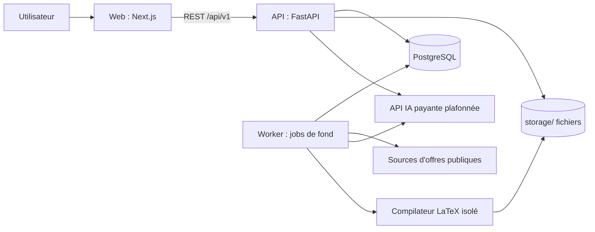

# Architecture de Happly AI

Version : 1.0 — 2026-11-03. Décisions détaillées : [ADR](ADR/README.md). Contexts métier : [BOUNDED_CONTEXTS.md](BOUNDED_CONTEXTS.md). Contrats : [MODULE_CONTRACTS.md](MODULE_CONTRACTS.md). Contraintes : [CONSTRAINTS.md](CONSTRAINTS.md).

## 1. Vue d'ensemble

Monolithe modulaire en Clean Architecture (ADR-0001), exécuté en local avec Docker Compose (ADR-0008), consommant des sources d'offres publiques et une API IA payante plafonnée.



## 2. Services d'exécution

| Service | Rôle | Remarques |
|---|---|---|
| `web` | Interface Next.js | Lié à `127.0.0.1` |
| `api` | API REST FastAPI, use cases | Lié à `127.0.0.1`, sans accès direct à la base depuis les routes |
| `worker` | Recherches, ingestion, analyses IA, génération de documents | Même base de code que l'API, processus séparé (ADR-0009) |
| `postgres` | Base de données | Unique source de vérité (ADR-0004) |
| `latex` | Compilation PDF isolée | Conteneur sans réseau, limites CPU/mémoire/temps (ADR-0007) |

Pas de Redis ni de Celery au départ : la file de tâches s'appuie sur PostgreSQL (ADR-0009).

## 3. Couches (backend)

```text
presentation  → routes FastAPI, schémas HTTP, middlewares, gestion d'erreurs API
application   → use cases, DTO, orchestration, interfaces (ports) vers l'extérieur
domain        → entités, value objects, règles métier, interfaces de repositories, exceptions métier
infrastructure→ repositories SQL, connecteurs, fournisseurs IA, stockage, compilateur, notifications
```

Règle de dépendance : `presentation` et `infrastructure` dépendent de `application`, qui dépend de `domain`. **Le domaine ne dépend de rien d'externe.** Aucune dépendance circulaire.

## 4. Organisation du code (cible)

```text
happly-ai/
├── apps/
│   ├── web/                 # Next.js (app, components, features, hooks, lib, services, styles, types)
│   └── api/
│       ├── app/
│       │   ├── core/        # configuration, logs, erreurs communes, sécurité transverse
│       │   └── modules/     # un dossier par bounded context
│       │       └── <contexte>/{domain,application,infrastructure,presentation}/
│       ├── migrations/      # Alembic
│       └── tests/           # unit, integration, api, security
├── packages/                # shared-types (générés depuis OpenAPI), design-system
├── infrastructure/          # docker, scripts, monitoring
├── documents/               # templates LaTeX
├── storage/                 # fichiers runtime (non versionné)
└── docs/
```

Choix : l'organisation **par module métier d'abord**, puis par couche à l'intérieur de chaque module, pour garder les frontières nettes et permettre l'extraction d'un module. Les dossiers `domain/application/...` de premier niveau de la spec sont donc déclinés **dans** chaque module.

## 5. Flux principaux

1. **Recherche** : l'utilisateur lance une recherche → l'API crée un job → le worker interroge les connecteurs en parallèle → normalisation → déduplication → persistance → l'interface lit les résultats paginés depuis la base.
2. **Analyse d'une offre** : scoring déterministe (sans IA) → si pertinente et autorisée, analyse IA via `AIGateway` (cache, plafond, journal d'usage) → résultat validé et versionné.
3. **Génération de CV** : sélection des faits du CV maître → génération LaTeX → vérification des faits → compilation isolée → extraction du texte → contrôle ATS → nouvelle version associée à l'offre.
4. **Candidature** : préparation automatisée, **envoi toujours manuel** par l'utilisateur.

## 6. Principes transversaux

- **Données brutes conservées**, données normalisées séparées ; absence d'information ≠ zéro.
- **Idempotence** de toutes les tâches de fond (clé d'idempotence, upsert).
- **Toutes les interactions IA** passent par une unique porte (`AIGateway`) : cache, plafond, journal, validation de sortie.
- **Toutes les sorties réseau** passent par un client contrôlé (SSRF, timeouts, rate limiting).
- **Contexte utilisateur** explicite dans chaque use case ; `owner_id` sur les données (ADR-0008).
- **Observabilité** : logs JSON, identifiant de corrélation propagé API → worker, health checks.

## 7. Contrats API

REST versionnée `/api/v1`, schéma OpenAPI généré par FastAPI, types TypeScript générés depuis ce schéma (jamais écrits à la main). Erreurs au format `application/problem+json` (voir [DEVELOPMENT_GUIDELINES.md](../engineering/DEVELOPMENT_GUIDELINES.md)).

## 8. Sécurité (résumé)

Liaison locale uniquement, secrets par variables d'environnement, validation stricte des entrées, fichiers importés non fiables, LaTeX isolé, annonces traitées comme données non fiables (prompt injection), RGPD. Détail : EPIC 018 et `docs/security/`.

## 9. Évolutions prévues

Authentification et multi-utilisateur, hébergement distant, stockage objet, modèle IA local, extraction éventuelle de modules en services.
