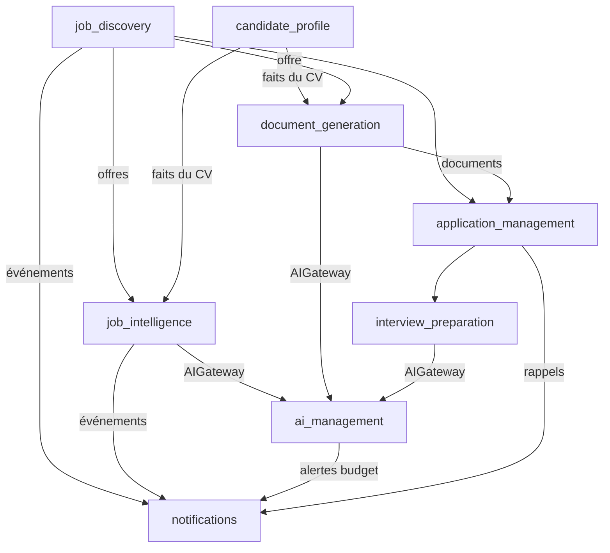

# Bounded contexts (TASK-001-05)

Chaque contexte est un module du monolithe (`backend/app/modules/<contexte>/`) avec ses propres couches. Un contexte possède ses données : aucun autre contexte n'écrit dans ses tables.

| Contexte | Responsabilité | Entités possédées | Epics |
|---|---|---|---|
| **candidate_profile** | CV maître, import, validation, préférences, historique | Candidate, CandidateProfile, Experience, Education, Certification, Skill, Language | 005 |
| **job_discovery** | Connecteurs, recherche multi-sources, ingestion, normalisation, déduplication, recherches sauvegardées | JobOffer, JobSource, SearchCriteria, SavedSearch | 006, 007, 008, 017 |
| **job_intelligence** | Scoring déterministe, analyse sémantique des offres | JobAnalysis, MatchScore | 009, 011 |
| **ai_management** | Fournisseurs IA, routage, budgets, plafonds, cache, journal d'usage | AIUsage, AIBudget, AICacheEntry, PromptVersion | 010 |
| **document_generation** | CV LaTeX, lettres, compilation, contrôle ATS, versions | GeneratedDocument, DocumentVersion | 012, 013 |
| **application_management** | Candidatures, statuts, historique, relances, Dashboard | Application, ApplicationEvent, Note, Contact | 014 |
| **interview_preparation** | Questions, simulations, suivi d'entretiens | InterviewPrep, InterviewSession | 016 |
| **notifications** | Notifications, résumés, rappels, e-mails consentis | Notification, NotificationPreference | 015 |

## Contextes techniques transversaux

| Module | Rôle |
|---|---|
| `core` | Configuration, logs, erreurs communes, contexte utilisateur, identifiants de corrélation |
| `jobs` | File de tâches PostgreSQL, scheduler (ADR-0009) |
| `platform` | Santé, observabilité, sauvegarde, paramètres généraux |

## Relations

Sens : « A → B » signifie que A fournit des données ou des événements à B, ou que B dépend d'une interface publique de A. Aucun cycle.

## Règles

- Un contexte n'expose que son interface publique (use cases et événements) ; ses repositories et entités internes ne sont pas importables par d'autres.
- Les références entre contextes se font par identifiant, pas par jointure vers les tables d'un autre contexte.
- Tout appel IA, quel que soit le contexte, passe par `ai_management`.
- Tout `owner_id` est géré par le contexte propriétaire de la donnée.
