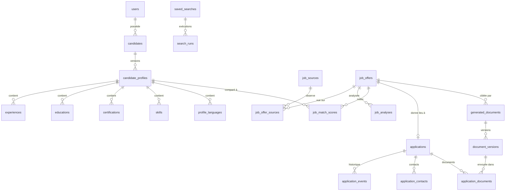

# Modèle de domaine (TASK-004-01, 004-02, 004-03, 004-04)

Les entités appartiennent à un bounded context (voir [BOUNDED_CONTEXTS.md](BOUNDED_CONTEXTS.md)). Le schéma physique est décrit dans [DATA_MODEL.md](DATA_MODEL.md). Les classes de domaine pures (agrégats, services) sont ajoutées avec les cas d'usage de chaque EPIC ; les modèles de persistance existent dès maintenant dans `backend/app/modules/<contexte>/infrastructure/models.py`.

## Value objects (`backend/app/core/domain/value_objects.py`)

| Value object | Règles |
|---|---|
| `CountryCode` | ISO 3166-1 alpha-2, normalisé en majuscules ; aucune liste fermée de pays |
| `LanguageCode` | BCP 47 simplifié (`fr`, `pt-BR`), normalisé ; `fr-` rejeté |
| `Money` | `Decimal` uniquement, jamais de flottant ; montant ≥ 0 et fini ; devise ISO 4217 ; addition refusée entre devises différentes |
| `DateRange` | début ≤ fin ; fin `None` = en cours |
| `EmploymentType` | permanent, fixed_term, freelance, internship, apprenticeship, part_time, temporary, other |
| `RemoteType` | on_site, hybrid, remote |
| `SkillLevel` | beginner à expert ; **absence de niveau = `None`**, pas « débutant » |

Règle transversale : une information absente est `None`/`NULL`, jamais zéro ni chaîne vide.

## Entités par contexte

| Contexte | Entités | Invariants principaux |
|---|---|---|
| candidate_profile | Candidate, CandidateProfile (versionné), Experience, Education, Certification, Skill, Language | Un candidat par propriétaire ; version de profil unique et ≥ 1 ; période valide ; compétence unique par profil sans tenir compte de la casse ; chaque élément porte son origine (importé/manuel) et sa date de validation |
| job_discovery | JobSource, TargetCompany, JobOffer, JobOfferSource (observation), JobOfferState, SavedSearch, SearchRun | Une observation par (source, identifiant externe) ; offre = fiche normalisée, donnée brute conservée dans l'observation ; fourchette salariale valide et accompagnée d'une devise ; URL canonique unique ; une entreprise ne s'active que si sa source est supportée, et une page non ATS que si ses CGU ont été vérifiées par une personne |
| job_intelligence | JobAnalysis, JobMatchScore | Une analyse par (offre, type, version du prompt, modèle, empreinte du texte) ; score entre 0 et 100, reproductible pour une version de pondérations |
| ai_management | AIUsage, AIBudget, AICacheEntry | Tokens et coûts ≥ 0 ; plafond > 0 ; un seul plafond global par période ; clé de cache unique |
| document_generation | GeneratedDocument, DocumentVersion | Versions immuables et numérotées sans doublon ; stockage par clé générée |
| application_management | Application, ApplicationEvent, ApplicationContact, ApplicationDocument | Une candidature par offre ; statut parmi les 12 définis ; un changement de statut porte son statut cible |
| notifications | Notification | — |

Le `SearchCriteria` est un objet de domaine sérialisé dans `saved_searches.criteria` et `search_runs.criteria`. Les notes de candidature sont des `ApplicationEvent` de type `note`.

## Relations

Toutes les tables de données portent un `owner_id` vers `users` avec suppression en cascade (ADR-0008, droit à l'effacement).

## Contraintes d'intégrité référentielle

| Relation | Comportement à la suppression |
|---|---|
| Utilisateur → toutes ses données | `CASCADE` |
| Profil → éléments du profil | `CASCADE` |
| Offre → observations, analyses, scores | `CASCADE` |
| Offre → candidature | `RESTRICT` (une offre suivie ne peut pas être supprimée par erreur) |
| Source → observations | `RESTRICT` (désactiver une source, ne pas la supprimer) |
| Offre → documents générés | `SET NULL` (les documents produits survivent à l'offre) |
| Version de document → candidature (CV/lettre) | `SET NULL` ; `RESTRICT` pour la liste des documents envoyés |
